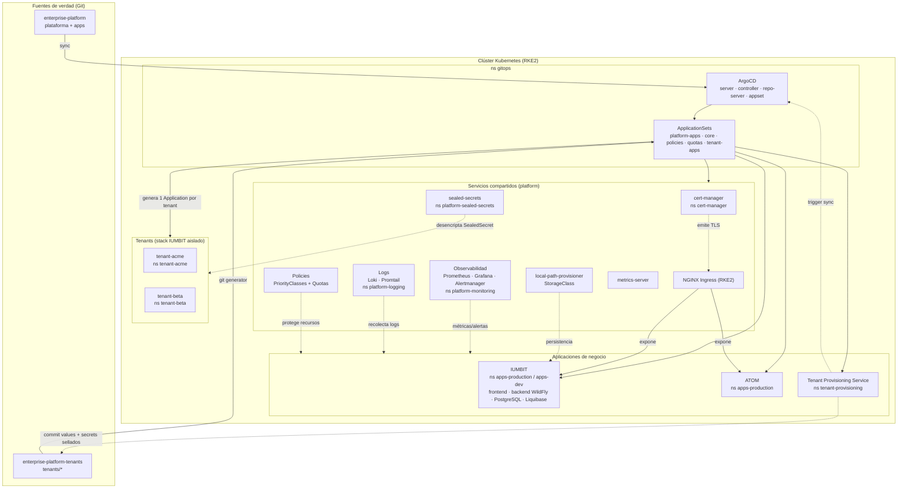
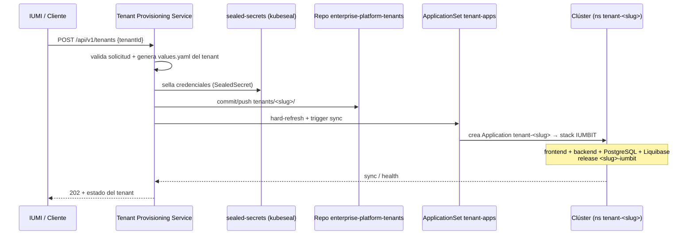

# Enterprise Platform - Diagrama de Operación

> Vista general (basta, sin detalle excesivo) de la plataforma **ya desplegada**:
> cómo opera, su estructura, los servicios desplegados y la capacidad de
> aprovisionamiento automático de stacks IUMBIT por tenant (ADR-0005).
>
> Complementa a `platform-topology.md` (layout de namespaces) y
> `platform-architecture.md` (visión de arquitectura).

---

## 1. Plataforma desplegada (estructura + operación)

**Cómo opera:** Git es la única fuente de verdad. Ansible sólo hace el bootstrap
inicial (RKE2 + ArgoCD). ArgoCD, mediante ApplicationSets, mantiene sincronizada
la plataforma (`platform/`) y las apps (`applications/`) de forma continua
(self-heal + prune). El ingress NGINX expone el tráfico; cert-manager emite TLS;
monitoring/logging observan todo; las políticas protegen recursos.

---

## 2. Agregado: aprovisionamiento de nuevos stacks IUMBIT

**La capacidad clave:** el TPS convierte una petición HTTP en un **stack IUMBIT
completo y aislado** (namespace `tenant-<slug>`, release `<slug>-iumbit`) sin
intervención humana. Reutiliza el *mismo* chart `applications/iumbit` mediante el
ApplicationSet `tenant-apps`, que observa el repo de tenants y genera una
Application por cada carpeta `tenants/*`. Los secretos de cada tenant viajan
cifrados como `SealedSecret`.

---

## 3. Llave de lectura rápida

| Bloque | Qué es | Dónde vive |
|--------|--------|------------|
| `gitops` | Motor GitOps (ArgoCD + ApplicationSets) | ns `gitops` |
| Shared services | Certificados, monitoreo, logs, storage, seguridad, políticas | ns `platform-*`, `cert-manager`, `local-path-storage`, `kube-system` |
| Apps de negocio | IUMBIT, ATOM, TPS | ns `apps-production` / `apps-dev` / `tenant-provisioning` |
| Tenants | N copias aisladas de IUMBIT | ns `tenant-<slug>` |
